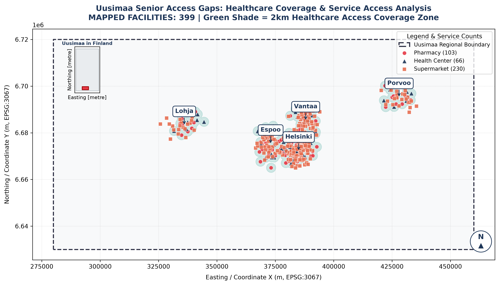

# Uusimaa Senior Services Accessibility & Spatial Access Gaps

[](https://www.python.org/)
[](https://geopandas.org/)
[-orange.svg)](https://epsg.io/3067)
[](LICENSE)

An end-to-end spatial analysis and cartographic project evaluating physical access to essential daily services—**Pharmacies, Health Centers, and Supermarkets**—for elderly populations across five key municipalities in the Uusimaa region of Finland (**Helsinki, Espoo, Vantaa, Porvoo, and Lohja**).

---

## Project Overview

Ensuring equitable access to healthcare and essential retail is critical for senior well-being and municipal planning. This project combines quantitative spatial analysis with cartographic design to evaluate facility distributions, quantify spatial service coverage, and highlight regional access cold spots (service gaps) across Uusimaa.



---

##  Key Spatial Findings & Methodology

1. **Spatial Reference System (EPSG:3067):**
   All datasets are projected using the national Finnish coordinate system **ETRS89 / ETRS-TM35FIN (EPSG:3067)** to ensure metric accuracy for distance and buffer computations.

2. **Healthcare Coverage Zones (2 km Buffers):**
   A 2,000-meter spatial service buffer was computed around all healthcare facilities (Pharmacies and Health Centers). The transparent green zones represent accessible boundaries for ambulatory seniors, making regional gaps between urban hubs immediately visible.

3. **Regional Disparities:**
   - **Metropolitan Core (Helsinki–Espoo–Vantaa):** Characterized by high facility density and overlapping 2 km service buffers.
   - **Outer Municipalities (Lohja & Porvoo):** Display distinct service clusters surrounded by vast unserved spatial pockets, underscoring areas where transport support or mobile healthcare is essential.

---

## 📊 Summary of Mapped Facilities

| Service Type | Map Symbol | Count | Primary Role in Senior Care |
| :--- | :---: | :---: | :--- |
| **Supermarkets** | 🟧 Square | 230 | Food security & daily essential supplies |
| **Pharmacies** | 🔴 Circle | 103 | Medication prescription & primary consultation |
| **Health Centers** | 🔷 Triangle | 66 | Primary clinical care & emergency services |
| **Total** | — | **399** | **Complete Regional Dataset** |

---

## 🛠️ Repository Architecture

The project follows a modular Python structure separating data ingestion, spatial modeling, and map rendering:

```text
uusimaa-senior-access-gaps/
├── data/
│   ├── uusimaa_services_map.png       # 300 DPI publication-quality static map
│   └── uusimaa_interactive_map.html   # Clustered Folium web map
├── src/
│   ├── __init__.py
│   ├── data_loader.py                 # Fetches & reprojects spatial POIs (EPSG:3067)
│   ├── network_analyzer.py            # Spatial distance & coverage zone algorithms
│   └── mapper.py                      # Matplotlib static & Folium interactive engines
├── main.ipynb                         # Master notebook driving the workflow
└── README.md                          # Project documentation
